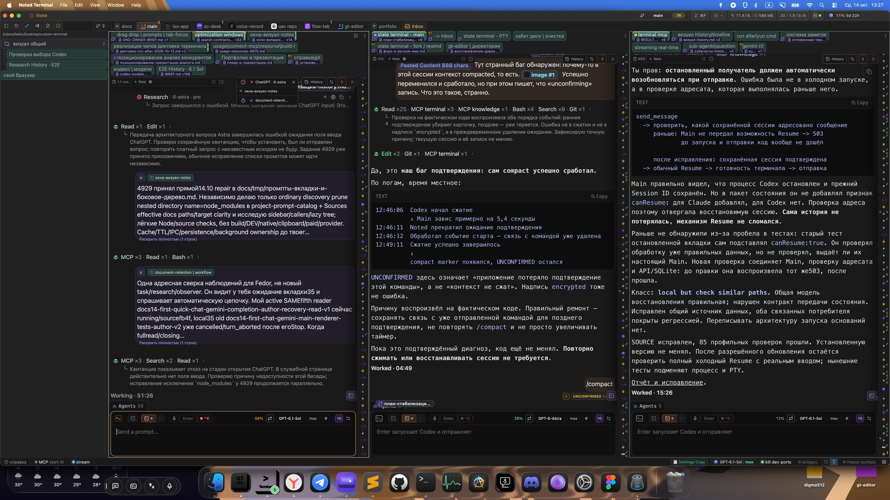
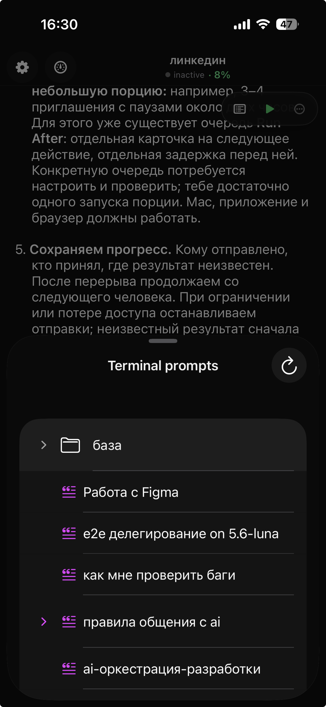
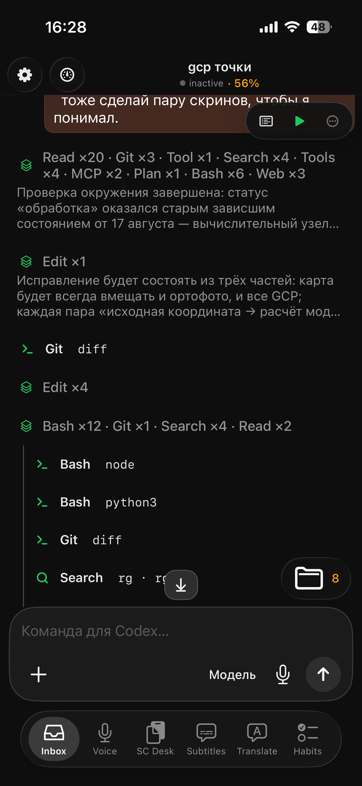
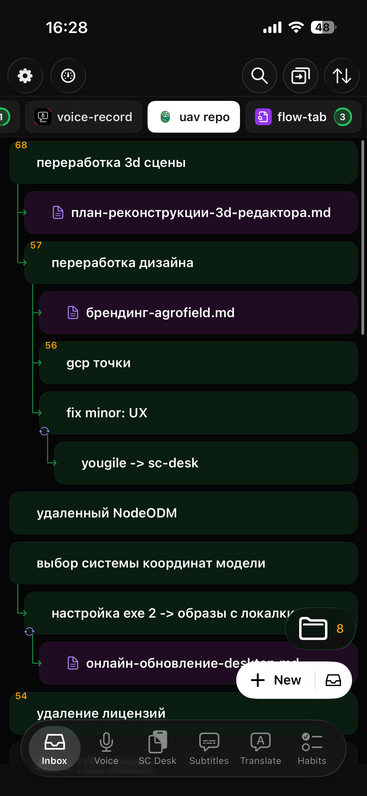

# Noted Terminal

**Рабочая среда для долгих задач с Claude Code и Codex на Mac.** Организуйте AI-сессии в окна и workflow, читайте историю, возвращайтесь к прошлым запросам и передавайте задачи между агентами, сохраняя доступ к настоящему терминалу.

Noted Terminal подходит разработчику, который параллельно ведёт реализацию, проверку и исследование и хочет видеть, какой сессии принадлежит задача, что она уже сделала и какой результат получен. CLI работают локально с вашими файлами и вашим аккаунтом.



*Реальный скриншот рабочего пространства. Текст внутренних обсуждений и личный путь скрыты.*

**macOS · исходники · локальные Claude/Codex CLI.** Начните с [установки для человека](docs/setup/macos.md) или передайте своему локальному AI [самодостаточную инструкцию установки](docs/setup/noted-terminal.prompt.md). Подписанного бинарного установщика в этом репозитории пока нет.

## От задачи до проверенного результата

Пример из личной разработки: при раскрытии видеоплеер повторно перематывал видео и начинал воспроизведение. Пользователь описал скачок и ожидаемое поведение; задача была передана отдельной рабочей сессии с Markdown-контекстом. После изменения обработчиков прошла отдельная проверка в настоящем браузере: на паузе и при проигрывании, в двух языках, с сохранением того же video element, позиции и звука. Результат вернулся владельцу задачи вместе с пределом проверки: слабая сеть и поведение декодера этим прогоном не подтверждались.

```text
Человек: описывает проблему и ожидаемый результат
  → рабочая вкладка: ответственность + контекст + поручение
    → агент: исследует причину и меняет код
      → проверка: воспроизводит исходный сценарий
        → результат: что исправлено, чем проверено, что осталось
```

Это пример индивидуальной работы автора, а не заявление о внедрении в команде. Человек выбирает цель, права и критерий готовности; количество запущенных моделей само по себе не подтверждает качество результата.

## Что можно делать

| Действие пользователя | Возможности |
|---|---|
| Организовать работу | Workflow, несколько окон/колонок, многострочные полосы вкладок, резерв и скрытые окна, поиск/переключение, пользовательские категории и избранное. Перенос вкладки не меняет её рабочую папку или разговор. |
| Читать и находить прошлое | History с Markdown, действиями инструментов и diff, поиск по истории, Timeline сообщений/compact, выбранные блоки и диапазоны, заметки и файловые связи. |
| Попробовать другой путь | Fork/Continue/Rewind и операции над диапазоном истории. Claude и Codex используют разные механизмы; [таблица ограничений](docs/features.md#история-и-провайдеры) описывает их отдельно. |
| Подготовить запрос | Общий composer, сохранённый draft, изображения/файлы/контекстные чипы, библиотека промптов, ручной ввод в живом CLI. Отправка и готовый ответ имеют отдельные состояния. |
| Запланировать продолжение | Очереди и Run After, ожидание выбранных вкладок, таймеры и Loop; Restart after для команд/dev-server. Ручной Stop, Pause очереди и завершение работы — разные действия. |
| Передать задачу агенту | Область ответственности и план вкладки, адресные вопросы/ответы, долговечная делегация, возврат результата, отложенные изменения контекста, точечное чтение чужой истории через Terminal MCP. |
| Подключить другой клиент | REST/SSE для project/tab управления; Codex-only Inbox API для внешнего чата. Нативный iPhone-клиент и companion-приложения устанавливаются отдельно. |
| Разобраться в состоянии | Context и provider usage, активность/процессы, ресурсы и кэши, экспорт диагностических логов. Usage провайдера, размер контекста и память компьютера не взаимозаменяемы. |

Подробнее: [возможности и границы](docs/features.md), [API/MCP и подключения](docs/api.md).

## Работа с iPhone

<table>
  <tr>
    <td width="33%"></td>
    <td width="33%"></td>
    <td width="33%"></td>
  </tr>
</table>

**Промпты, чат и вкладки — тот же рабочий контекст с телефона.** Можно выбрать сохранённый промпт, читать ответ и действия агента, переключаться между workflow, вкладками и связанными документами. Это отдельный нативный [Main iOS App](https://github.com/RevinFedor/main-ios-app), подключённый к API работающего Noted Terminal на Mac. Телефон получает данные сессии; приложение на Mac исполняет запросы. Подключение описано в [API/MCP](docs/api.md).

## Быстрый запуск из исходников

Проверяемый путь этой публикации — macOS arm64, Node.js **22.12+ из ветки 22**, Git, Python 3 и Xcode Command Line Tools. Claude Code или Codex устанавливается отдельно и требует вашего входа/доступа к провайдеру. Нужные интерфейсные библиотеки включены в checkout; соседние репозитории автора не требуются.

```bash
git clone https://github.com/RevinFedor/custom-terminal.git
cd custom-terminal
npm ci
npm run rebuild:native
npm run build:renderer
npm run test:setup
```

Сборка выше ограничена checkout. Для полноценного запуска подготовьте helpers по [инструкции](docs/setup/macos.md): сначала dry-run, затем `install:terminal-mcp`/`install:claude-hook` и `npm run dev`. Установщики обновляют managed записи глобальных CLI-конфигов с backup, а не только этот checkout.

Откройте workflow/вкладку, выберите рабочую папку и запустите установленный CLI. Выполните native login. Только после готовности ввода отправьте короткий согласованный запрос; успех — ответ в History, а не просто появившийся процесс.

**Режим доступа:** управляемые запуски в этой версии используют Claude `--dangerously-skip-permissions` и Codex `--dangerously-bypass-approvals-and-sandbox`. Они рассчитаны на доверенный локальный проект; ознакомьтесь с этим режимом до первого запуска агента. Настройка и сборка сами не запускают inference.

Логин с подпиской CLI и API-ключ — разные способы доступа. Не требуется покупать отдельный ключ для установки Noted; запросы расходуют квоту выбранного аккаунта или деньги выбранного API. Не вводите credentials в AI-чат.

Дополнительные сервисы настраиваются через локальный ENV: [ключи и `.env.example`](docs/setup/keys.md).

## Что опубликовано и проверено

Репозиторий сохраняет историю разработки и поставляет исходники с переносимыми зависимостями. Из исторических версий удалены ключи, личные экспорты, базы и runtime-конфиги. Незакоммиченные изменения текущих рабочих сессий не являются частью этой публикации.

Проверки опубликованного исходника и их ограничения приведены в [verification](docs/verification.md). Сборка на машине автора и clone без credentials не являются установкой на другом Mac. Windows/Linux и Intel Mac не прошли такую же приёмку.

- Отдельный no-GUI daemon не поставляется: для API нужен работающий desktop runtime.
- Native iPhone, SC Desktop/Voice Record, GT Editor, browser/Electron/iOS MCP — отдельные optional интеграции. Их установка не происходит автоматически.
- Knowledge MCP не нужен для обычной AI-сессии и не включён как обязательный внешний сервис. Подключайте версию, соответствующую своему проекту.
- `mobile-web/` — legacy браузерная поверхность.
- Постоянный Gemini-наблюдатель, новый quick-chat и автоматические вопросы в Telegram не объявлены выпущенными этим снимком.

## Дальше

- [Установка на macOS](docs/setup/macos.md) · [Markdown для вашего AI](docs/setup/noted-terminal.prompt.md)
- [Возможности](docs/features.md) · [Архитектура и API](docs/api.md)
- [Ошибки и диагностика](docs/troubleshooting.md)
- [Разработка и вклад](docs/development.md) · [Third-party notices](THIRD_PARTY_NOTICES.md)
- [MIT License](LICENSE)
