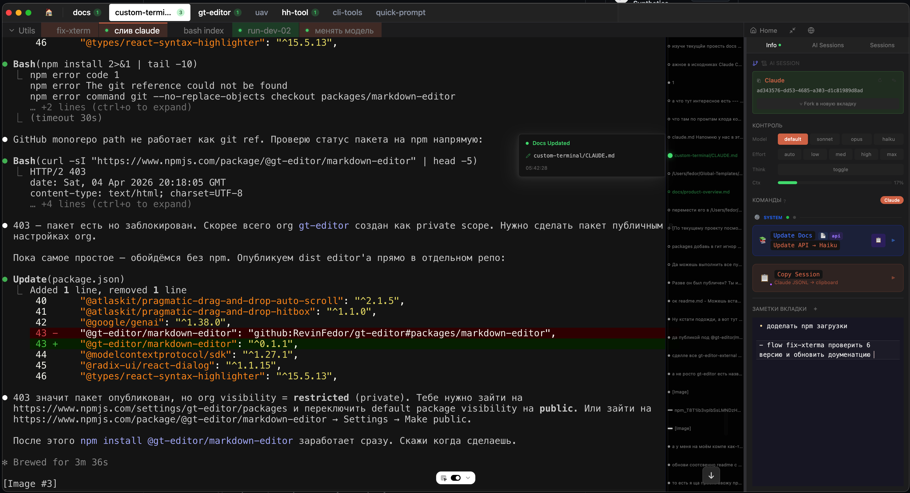

<p align="center">
  <h1 align="center">Noted Terminal</h1>
  <p align="center">
    Terminal-native API/workbench для Claude Code и Codex CLI.<br/>
    Не обёртка над SDK — живой терминал + детерминированный PTY/JSONL control layer.
  </p>
</p>

<p align="center">
  
</p>

<table>
  <tr>
    <td width="34%">
      
    </td>
    <td>
      <h3>Mobile terminal control</h3>
      <p>
        Для управления терминалами с телефона используется отдельное нативное приложение
        <a href="https://github.com/RevinFedor/main-ios-app">Main iOS App</a>.
        Оно подключается к REST/SSE API Noted Terminal, показывает проекты и вкладки,
        управляет Claude/Codex/SDK-сессиями, отправляет prompt'ы, делает interrupt/resume,
        читает history/timeline/queue и запускает build-install без web-зеркала терминала.
      </p>
    </td>
  </tr>
</table>

## Related Repositories

- [AI Mac Electron](https://github.com/RevinFedor/ai-mac-electron) — macOS companion app for system dictation, desktop Gemini chat, prompt library, and the Voice Record REST/SSE API used by the iOS client.
- [Main iOS App](https://github.com/RevinFedor/main-ios-app) — native iPhone control surface for Noted Terminal projects/tabs and AI Mac Electron chat/voice workflows.

---

## Что это

Noted Terminal запускает настоящие локальные AI CLI в терминале и превращает их в управляемые сессии: внешний агент или мобильный клиент может создать вкладку, запустить Claude/Codex, отправить prompt, остановить turn/process, прочитать историю и сделать fork/edit без переписывания собственного terminal parser.

Главная ценность не в UI-оболочке, а в готовом слое управления:

- **PTY/TUI control:** безопасная доставка prompt/slash-команд в живой `claude`/`codex`, без `claude -p` как основного пути.
- **Structured history:** Claude JSONL и Codex rollout парсятся в Timeline/History, а не в сырой terminal scrollback.
- **MCP API:** внешние AI-клиенты управляют вкладками и читают/редактируют историю через MCP.
- **Mobile REST/SSE API:** телефон и нативные клиенты используют тот же backend, что desktop UI.
- **Event-driven status:** завершение turn'а, prompt-ready, CWD, session id и context% берутся из событий/транскриптов; таймеры только fallback.

Подробнее по продуктовой рамке:

- [docs/product/наш-терминал.md](docs/product/наш-терминал.md)
- [docs/product/анализ-конкурентов.md](docs/product/анализ-конкурентов.md)

---

## API surfaces

### 1. Terminal MCP — управлять живыми вкладками

Для внешнего AI это основной путь: он не пишет bytes в PTY напрямую, а вызывает готовые tools.

| Tool | Что делает |
|---|---|
| `list_projects` | показывает открытые проекты Noted Terminal |
| `list_tabs` | показывает вкладки, live PID, commandType, sessionId |
| `create_tab` | создаёт terminal/AI вкладку |
| `start_ai` | запускает или resume'ит Claude/Codex через native launch hooks |
| `send_prompt` | доставляет prompt в live AI TUI через TUI-safe paste |
| `stop_ai` | останавливает AI process, не уничтожая shell tab |
| `run_command` / `restart_process` / `kill_process` | управляет обычными shell/dev-server вкладками |
| `read_output` | читает хвост terminal output как fallback |

Где смотреть:

- MCP wrapper: [mcp/terminal-server.mjs](mcp/terminal-server.mjs)
- HTTP backend: [src/main/main.js](src/main/main.js) — `startMcpHttpServer()`, routes `/terminal/*`
- docs: [docs/knowledge/fact-terminal-mcp.md](docs/knowledge/fact-terminal-mcp.md), [docs/knowledge/fact-mcp-routing.md](docs/knowledge/fact-mcp-routing.md)

Минимальный сценарий для внешнего агента:

```text
list_projects
→ list_tabs { color: "" }
→ create_tab или start_ai
→ send_prompt { tabId, prompt }
→ wait через Overseer busy/status
→ get_assistant_text / list_turns
```

### 2. Overseer MCP — читать и редактировать историю

Overseer — read/edit API поверх Claude JSONL и Codex rollout. Он нужен, когда важно не "что видно на экране", а что реально записано в транскрипте.

| Tool | Что делает |
|---|---|
| `list_open_sessions` | все Claude/Codex сессии во всех открытых проектах |
| `session_stats` | масштаб сессии без загрузки контента |
| `list_turns` | карта ходов: previews, размеры блоков, tool names |
| `get_user_prompt` / `get_thinking` / `get_assistant_text` | точечное чтение нужного блока |
| `list_notes` | заметки и rewind-маркеры Timeline |
| `fork_session` | безопасная копия Claude-сессии |
| `propose_edit` | dry-run edit/delete range |
| `apply_edit` | реальное Claude edit-range/delete-range через тот же pipeline, что UI |

Где смотреть:

- MCP wrapper: [mcp/overseer-server.mjs](mcp/overseer-server.mjs)
- HTTP backend: [src/main/main.js](src/main/main.js) — routes `/overseer/*`
- Claude parser/edit engine: [src/main/ipc/claude-data.js](src/main/ipc/claude-data.js)
- Codex parser: [src/main/ipc/codex-data.js](src/main/ipc/codex-data.js)
- docs: [docs/knowledge/fact-overseer-mcp.md](docs/knowledge/fact-overseer-mcp.md), [docs/knowledge/fact-backtrace-jsonl.md](docs/knowledge/fact-backtrace-jsonl.md)

Граница: Codex через Overseer сейчас read-only. У Codex нет Claude `parentUuid` DAG и edit-range модели, поэтому fork/edit/apply для Codex намеренно unsupported.

### 3. Mobile / external REST + SSE API

Mobile API уже используется web/mobile клиентами и нативным iOS-клиентом. Это не web-зеркало терминала: клиент получает структурные snapshots/history/timeline/events и отправляет команды в тот же backend.

Ключевые endpoints:

```text
GET  /api/projects
GET  /api/projects/:id/tabs
POST /api/projects/:id/agent-tabs        { toolType: "claude" | "codex" }
POST /api/sdk-tabs/:tabId/send
POST /api/sdk-tabs/:tabId/interrupt
POST /api/sdk-tabs/:tabId/stop
POST /api/sdk-tabs/:tabId/resume
GET  /api/sdk-tabs/:tabId/status
GET  /api/sdk-tabs/:tabId/history
GET  /api/sdk-tabs/:tabId/timeline
GET  /api/sdk-tabs/:tabId/params
POST /api/sdk-tabs/:tabId/params
GET  /api/events?token=&tabId=           # SSE live channel
```

Где смотреть:

- REST/SSE backend: [src/main/web-server.js](src/main/web-server.js)
- renderer bridge actions: [src/renderer/App.tsx](src/renderer/App.tsx)
- mobile frontend: [mobile-web/](mobile-web/)
- docs: [docs/knowledge/fact-mobile-web.md](docs/knowledge/fact-mobile-web.md), [docs/knowledge/fact-mobile-claude-pty.md](docs/knowledge/fact-mobile-claude-pty.md)

### 4. Core source map

Если нужно встроить или переиспользовать только terminal/API слой, начинать отсюда:

| Файл | Зачем читать |
|---|---|
| [src/main/main.js](src/main/main.js) | PTY lifecycle, `safePasteAndSubmit`, Claude/Codex launch, Stop/interrupt, MCP HTTP |
| [src/main/ipc/claude-data.js](src/main/ipc/claude-data.js) | Claude JSONL: session file lookup, active-branch backtrace, fork/edit/delete range |
| [src/main/ipc/codex-data.js](src/main/ipc/codex-data.js) | Codex rollout: timeline/history/context/compact parsing |
| [src/main/web-server.js](src/main/web-server.js) | mobile/native REST API, SSE, live JSONL tail |
| [src/renderer/components/Workspace/Terminal.tsx](src/renderer/components/Workspace/Terminal.tsx) | xterm lifecycle, pendingAction launch, prompt readiness |
| [src/renderer/components/Workspace/ClaudeControlBar.tsx](src/renderer/components/Workspace/ClaudeControlBar.tsx) | user-facing controls for model/effort/stop/fork/copy prompt |
| [src/renderer/components/Workspace/Timeline.tsx](src/renderer/components/Workspace/Timeline.tsx) | Timeline, range selection, edit-range UI |

---

## Demo flow

Самая короткая демонстрация продукта:

1. Открыть Noted Terminal с живой Claude/Codex вкладкой.
2. Рядом открыть mobile client или `mobile-web`.
3. Написать prompt в desktop History/agent input.
4. Показать, что mobile side получает тот же turn через REST/SSE: user message, busy, assistant output, status/context.
5. Нажать mobile interrupt/stop/resume или поменять params — desktop остаётся источником живого процесса, mobile только внешний клиент.

Это демонстрирует главное: API уже существует и используется реальным вторым клиентом. Мобилка не парсит терминальный экран и не запускает свой Claude; она ходит в backend Noted Terminal, который сам владеет PTY, JSONL/rollout parsing, session status и history.

---

## Проблема

Все AI-инструменты теряют контекст: сессия закончилась → агент забыл всё. С 1M контекстом один агент умеет почти всё, но через 2 часа окно забито мусором — начинаешь заново или чистишь вручную. А когда параллельно открыто 5 сессий — ни одна не знает что делают остальные.

**Noted Terminal даёт пять вещей, которых не даёт обычный терминал или SDK-wrapper:**

| | Возможность | Суть |
|---|---|---|
| 🔌 | **Terminal/API layer** | Готовый MCP/REST/SSE доступ к живым Claude/Codex сессиям |
| 🔀 | **Fork / Rewind / Edit Range** | Git для диалогов с AI |
| 🧠 | **Knowledge Base + Semantic Router** | Персистентная память проекта между сессиями |
| 📊 | **Visual Timeline** | История как дерево, а не лог |
| 🎛️ | **Cross-Session Access** | Любая вкладка читает и редактирует историю любой другой |

> Под капотом — не spawn-subprocess-и-собери-stdout. Приложение **полностью парсит** PTY-поток и JSONL-транскрипты активных CLI (Claude и Codex), превращая живую сессию в структурированное, адресуемое состояние. На этом стоит всё остальное.

---

## Features

### 🔀 Context Management

<details>
<summary><b>Fork</b> — клонирование сессии в один клик</summary>

Нажал кнопку → получил полную копию истории в новом табе, оригинал не тронут. `fs.copyFile` JSONL + перезапись всех `sessionId` на новый UUID (чтобы Timeline не показал ложную Clear-Context границу).

Основной паттерн: **Fork → вырезать ненужное → продолжить с чистой историей.**

</details>

<details>
<summary><b>Edit Range</b> — компактирование мусора в резюме</summary>

Выделяешь диапазон на Timeline (например 30 шагов где агент не мог пройти тесты) → диапазон сжимается в одно резюме: *"пробовали X, Y, Z — не вышло, ошибка была в W"* → JSONL атомарно редактируется (backtrace + forward-expand + relink `parentUuid` + orphan cleanup), агент рестартует с чистым контекстом.

Контекстное окно освободилось, суть сохранилась. Тот же движок доступен другим агентам через MCP (см. Cross-Session Access).

</details>

<details>
<summary><b>Rewind</b> — откат к любому сообщению</summary>

ПКМ по точке на Timeline → терминал автоматически навигирует по TUI-меню Claude (Escape → стрелки → выбор → Enter) → агент откатывается + получает резюме удалённого контекста.

По сути **Ctrl+Z для разговора с AI** — вернуться в точку где всё было хорошо и пойти другим путём.

</details>

---

### 🧠 Knowledge Base + Semantic Router

70+ файлов `docs/knowledge/` — **персистентная память проекта**, которая переживает любую сессию:

| Тип | Содержимое |
|-----|-----------|
| `fact-*` | Как работают подсистемы, API-лимиты, ограничения платформ |
| `fix-*` | Баги которые стоили часов: что пробовали, почему не сработало, как починили |

> Записывается только то, что AI **не может вывести из кода**: мотивация, отброшенные подходы, неочевидные связи.

**Как работает поиск:**

```
Пользователь: "почему sync возвращает 0 полей ???"
                                                  ↓
              UserPromptSubmit хук перехватывает промпт по триггеру ???
                                                  ↓
              Промпт + .semantic-index.json → Claude Haiku
                                                  ↓
              Haiku выбирает 2-4 релевантных файла по тегам и симптомам
                                                  ↓
              Содержимое файлов инжектится в контекст агента
                                                  ↓
              Агент сразу знает: "Axenta имеет telemetryAccountId: null,
              искать нужно через userId"
```

- **`???`** в промпте — ручной триггер, Haiku роутинг
- **`docs_search` MCP** — агент сам вызывает когда работает с незнакомой подсистемой
- **`build-index.sh`** — офлайн-индексация: Haiku извлекает explicit-темы, implicit-концепции и symptoms из каждого файла

> Новый агент (хоть другая модель через полгода) за 5 минут входит в проект на уровне, недостижимом для человека за неделю.

---

### 📊 Timeline

Вертикальная полоса справа — **каждая точка = сообщение**.

- Клик → скролл терминала к сообщению
- Наведение → превью текста промпта
- Session chain: `(root)` → `(plan mode)` → `(fork)` с маркером активной ветки
- **History Panel:** полная markdown-рендеренная история с syntax highlighting и diff-view
- Compact counter `♻️ ×N`, token usage, длительность каждого хода
- Якоря: пользовательские заметки (фиолетовые), rewind-маркеры (розовые), docs-update индикаторы (зелёные)
- Range copy: выбор диапазона сообщений для экспорта

---

### 🎛️ Cross-Session Access

**Не оркестратор, раздающий задачи. Peer-модель: любая вкладка имеет доступ к любой другой.**

Claude Code в PTY-табе, Claude SDK-таб, Codex — любой локальный чат, подключённый к MCP, может **прочитать историю** и **отредактировать** любую другую сессию в приложении. Открыл 5 сессий (фича, багфикс, рефакторинг, форк) — спрашиваешь одну из них *«что сейчас делается в остальных и на чём они остановились»*, и получаешь ответ из распарсенных транскриптов, а не из догадок по имени вкладки.

Работает это потому что весь парсинг JSONL обоих агентов экспонирован через HTTP в main process. Два глобальных stdio-MCP — тонкие обёртки над ним:

<details open>
<summary><b>overseer MCP</b> — контроль сессий (чтение + редактирование истории)</summary>

Гранулярный доступ: агент **сам решает сколько контекста забрать**. Сначала карта сессии (только размеры), потом точечный pull нужных блоков. Сессия 19MB / 262 turn'а → читаемый overview за **~6K токенов** — без затягивания дампа в контекст.

| Tool | |
|------|--|
| `list_open_sessions` | все Claude/Codex табы во всех проектах: sessionId, isLive, cwd, когда создан |
| `session_stats` | масштаб без контента: turn count, char-counts по ролям, largest turns, compact'ы |
| `list_turns` | карта ходов: preview + размеры thinking/text-блоков + имена tool_uses (контент НЕ грузится) |
| `get_user_prompt` · `get_thinking` · `get_assistant_text` | точечный pull одного блока, byte-range для больших |
| `list_notes` | пользовательские якоря на Timeline (заметки, rewind-маркеры, docs-edits) |
| `fork_session` | клон сессии под новым UUID |
| `propose_edit` | dry-run: что именно будет удалено, без записи на диск |
| `apply_edit` | реальная правка JSONL через **те же IPC что Timeline-кнопка** (backtrace, relink, orphan cleanup, atomic write); auto-fork по умолчанию |

**Safety:** первая правка сессии автоматически делает fork и оперирует на копии — оригинал нетронут, откат = закрыть таб форка. Редактирование никогда не пишет JSONL напрямую: только через обкатанные edit-range / delete-range пути, которые знают про compact-границы и parentUuid-цепочку.

</details>

<details>
<summary><b>terminal MCP</b> — контроль вкладок (живые процессы)</summary>

| Tool | |
|------|--|
| `list_tabs` | вкладки проекта: что запущено, PID, цвет, тип (claude / codex / devServer / shell) |
| `run_command` · `restart_process` · `kill_process` | управление процессом в табе |
| `read_output` | хвост вывода терминала |
| `create_tab` · `run_chain` | создание вкладок, последовательные пайплайны |

Project-scoped (фильтрует по cwd). Управляет **живым** состоянием, не историей.

</details>

> **Граница чёткая:** terminal MCP — *оператор* (что сейчас крутится, перезапустить/убить), overseer MCP — *историк/редактор* (что сессия сделала, прочитать/переписать). Разный blast radius: terminal может убить dev-сервер, overseer переписать транскрипт. Подключаешь оба, когда нужно и то и другое — конфликта нет, оба ходят в один main-process HTTP.

**Типичный flow:** внешнему чату даёшь имя проекта → `list_open_sessions` показывает вкладки → `session_stats` + `list_turns` локализуют где мясо → `get_thinking` на ключевой ход → *«сессия багфикса застряла на 30 итерациях вокруг loader'а, не смогла поднять dev через MCP»*. Захотел почистить → `propose_edit` показывает план, `apply_edit` сжимает диапазон в summary на форке.

---

### ⌨️ TUI Control (Claude & Codex)

Управление обоими CLI напрямую из UI — детерминированно, через парсинг PTY-потока, без `setTimeout`.

**Claude**

| Команда | Что делает |
|---------|-----------|
| `/model` | `default \| sonnet \| opus \| haiku` из UI-кнопки. Command Guard блокирует double operations |
| `/effort` | `low \| medium \| high \| xhigh \| max` — уровень reasoning (single source в `claudeLevels.ts`) |
| `meta+t` | Think mode — парсинг picker menu, навигация стрелками |
| Stop hook | Детерминированный конец turn'а: `UserPromptSubmit`/`Stop` хуки → Unix socket → authoritative loader |

**Codex**

| Команда | Что делает |
|---------|-----------|
| `/model` | Два последовательных picker'а (модель → effort), парсинг через PTY-кадры, не таймауты |
| `--model` / effort | Передаются прямо в process-start args (`-c 'model_reasoning_effort=...'`), не через TUI |
| Draft stash | Native `Ctrl+C` сохраняет недописанный composer в history перед сменой модели |
| Stop | `terminal:stop-ai-process` — controlled kill-ladder (`\x03` → SIGTERM → SIGKILL) по PID агента |

> У Codex нет отдельного Think-toggle — reasoning effort идёт через тот же `/model` flow, что и модель. Loader держится на rollout-событиях `task_started` / `task_complete` / `turn_aborted`, а не на эвристиках спиннера.

---

### 📝 Docs Pipeline

В конце сессии вставляешь промпт `docs-rules.prompt.md` → агент анализирует изменения → обновляет `docs/knowledge/`. Фильтрация: только невидимый контекст (мотивация, шрамы, неочевидные связи — не пересказ кода). Индекс пересобирается через `build-index.sh`.

### 🔎 Documentation Search MCP

Для поиска по проектной документации используется отдельный публичный пакет
[docs_search MCP](https://github.com/RevinFedor/docs_search_mcp). Проект хранит факты, шрамы и методологию в `docs/`, а `.semantic-index.json` выступает компактной картой: агент отправляет в `docs_search` симптом или задачу, MCP выбирает нужные markdown-файлы, и агент читает их в контекст перед изменением кода.

После существенных изменений в документации индекс пересобирается через MCP `docs_reindex` или напрямую:

```bash
bash scripts/ai/build-index.sh --gemini-write
```

---

## Getting Started

> **macOS only.** Приложение использует `node-pty` и shell integration, заточенные под macOS. Windows/Linux не тестировались.

```bash
git clone https://github.com/RevinFedor/custom-terminal.git
cd custom-terminal
cp .env.example .env        # вписать API-ключи (см. комментарии внутри)
npm install
npm run dev                  # dev mode с hot-reload
```

**Production build:**

```bash
npm run build:i              # собирает, копирует в /Applications, запускает
```

**MCP-серверы** (overseer / terminal) регистрируются глобально один раз:

```bash
claude mcp add overseer node "$(pwd)/mcp/overseer-server.mjs" --scope user
claude mcp add terminal node "$(pwd)/mcp/terminal-server.mjs" --scope user
```

После этого любой агент в любом проекте получает к ним доступ.

## Tech Stack

| | Технология |
|---|---|
| Runtime | Electron 28 |
| Frontend | React 19 + Vite + TypeScript |
| State | Zustand |
| Terminal | xterm.js (Canvas renderer) |
| Styling | Tailwind CSS v4 |
| DB | SQLite (sessions, projects, tabs) |
| AI Rendering | react-markdown + remark-gfm + syntax-highlighter |
| Agents | Claude Code (PTY + Agent SDK), Codex CLI (PTY). Gemini integration is legacy/partial and not part of the current public positioning. |

---

## Architecture

<details>
<summary><b>Event-Driven — таймеры только fallback</b></summary>

Всё критичное управление через события, не через "подождать N секунд":
- `safePasteAndSubmit` с sync marker verification (`\x1b[?2026l`)
- OSC 7777 маркеры → xterm.js IMarker на точную строку
- OSC 133 детектит начало/конец команды, OSC 7 трекает CWD
- Claude busy state: Stop hook (`UserPromptSubmit`/`Stop`) → Unix socket → UI/Mobile/MCP status
- Codex busy state: rollout events `task_started` / `task_complete` / `turn_aborted`
- Safety timers есть только как аварийный выход, не как источник truth
- Результат: меньше потерянных команд, race conditions и ложных "агент закончил"

</details>

<details>
<summary><b>PTY & JSONL Parsing — две модели транскрипта</b></summary>

Приложение читает не скриншот терминала, а структурированный транскрипт. У двух агентов он устроен по-разному, и парсер это учитывает:

**Claude — parentUuid DAG**
- **Backtrace** — обратный обход `parentUuid` цепочки с пропуском Escape-отменённых веток
- **Bridge following** — автоматический переход между файлами при Clear Context / Plan Mode
- **Incremental reader** — async чтение только новых байт, race-safe снапшот перед `await`
- **Compact boundary recovery** — `compact_boundary` + `isCompactSummary` пишутся парой записей; двухуровневый fallback восстанавливает историю после `/compact`
- **Sub-agent progress** — группировка по `parentToolUseID`, inline в timeline

**Codex — линейный rollout**
- Session id из `session_meta.payload.id` в `~/.codex/sessions/YYYY/MM/DD/rollout-*.jsonl` (append-only, парсер игнорирует битый хвост)
- Timeline из `event_msg.user_message` + `turn_context` (model/effort) + `token_count` (context% / rate-limits)
- History из `response_item`: reasoning summary → thinking, message → ответ, `function_call` + output → tool card
- Compact из top-level `type:"compacted"` с `payload.replacement_history`; `thread_rolled_back` откатывает turn'ы
- Нет parentUuid-DAG: Overseer читает Codex, но fork/edit через Overseer намеренно не поддерживаются

Обе модели отдаются через единый HTTP-слой в main, поверх которого работают Timeline UI, History Panel и overseer MCP.

</details>

<details>
<summary><b>Session Management</b></summary>

**Claude** — три метода детекции sessionId:
- **StatusLine Bridge:** shell script после каждого ответа Claude → `~/.claude/bridge/` (с защитой от stale-takeover: проверка `updated_at` + `transcript_path` + ppid)
- **Sniper Watcher:** `fs.watch` + 1s polling fallback, snapshot filtering
- **Manual entry:** real-time validation на диске

Session chain resolution: обход Plan Mode / Clear Context / Fork через `resolveSessionChain()` (backward) и `resolveLatestSessionInChain()` (forward).

**Codex** — `codexKnownSessions` Map из rollout-watcher'а: нет statusline-bridge, durable state — сам rollout JSONL. Resume/fork восстанавливаются из транскрипта, не из RAM. Для `codex-f` (fork) watcher принимает файл по cwd-match или по `sourceSessionId` внутри JSONL.

</details>

<details>
<summary><b>Rendering & Performance</b></summary>

- `TERM_PROGRAM=vscode` — Ink переключается на xterm.js-оптимизированный path (убрало 90% scroll jitter)
- Sync frame protection: BSU/ESU buffering → atomic write
- Canvas renderer (не WebGL) — instant tab switching, stale recovery
- GPU compositor: `will-change: transform`, React 19 `startTransition` для 200+ entries

</details>

<details>
<summary><b>Workspace & Projects</b></summary>

Multi-project: каждый проект = набор табов + sessions + notes.
- Левый `TabSidebar` (drag-resize), tab-группы, visual-child вкладки (fork → visual child источника)
- Auto-naming (`claude-N`, `codex-N`, `docs-XX`), AI auto-title по первому prompt, цвета, drag-and-drop
- Multi-select: Shift+Click range, Cmd+Click toggle, batch operations
- SQLite persistence с safety guard (no silent data loss)
- Terminal buffer serialization: save/restore при switch между табами
- Dashboard: процесс-мониторинг (In-App vs External), stop button, Tab History (reopen закрытых)

</details>

---

## Testing

Two-tier + live MCP:

| Уровень | Runtime | Скорость | Что тестирует |
|---------|---------|----------|--------------|
| Headless | Node.js | <1s | JSONL parsing, backtrace, TUI markers |
| E2E | Electron + `mcp__electron__*` | 15-60s | Store polling, OSC signals, real PTY, drag/IPC/dialog |

Event-driven: `waitForClaudeSessionId`, `findInLogs('BoundaryMarker')`, no `waitForTimeout`. Методология — глобальный skill `electron-e2e-testing`.

---

## License

MIT

> ! Documentation is routed through `docs_search MCP`: agents call `docs_search`, receive relevant files from `.semantic-index.json`, and read those files into context before non-trivial code changes.
